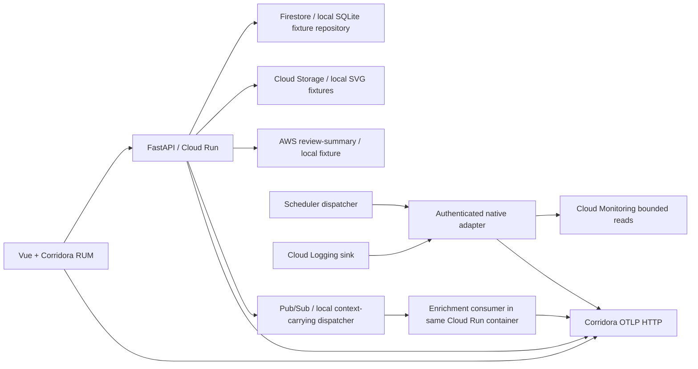

# The Recipe Table

Published 2026-10-11 · Updated 2026-10-11

A standalone Vue 3 / FastAPI recipe collection built to demonstrate browser,
API, database, cross-cloud and background-work investigation in Corridora.
Search by ingredient, open a recipe, and ask the kitchen worker to prepare notes.
All content and reviews are deterministic fictional fixtures.

Use Python **3.14** (3.12+ supported), Node **26** (22.12+ supported), and npm.
Cloud deployment also requires the current `gcloud` CLI and an existing
billing-enabled GCP project. No other sample is needed for a local start.

```sh
./setup
```

The wizard collects your destination, credentials and local/cloud settings, builds
the frontend and dependencies, then starts and verifies the app. Verification
installs the pinned Playwright Chromium when no custom executable is configured.
Browser/backend export is disabled locally when its
respective key is blank; the app still runs. Choose your own Corridora tenant, or
use Demo **only** with keys supplied by an authorized Corridora operator.

For a repeatable local workflow:

```sh
./setup configure
./setup deploy
npx playwright install chromium
./setup run
# In another terminal, with the server running:
./setup verify
./setup scenario --phase regression --duration 120
./setup scenario --phase recover --duration 120
```

The URL defaults to `http://localhost:4103`. Read the app-specific
[Set up Corridora guide](docs/corridora-setup.md) before enabling export.
`./setup --help` needs only Python's standard library.

## Application and telemetry paths



Python uses the actual OpenTelemetry SDK for trace, log and metric providers and
OTLP/HTTP protobuf exporters. The RUM script owns browser provider initialization;
Vue actions use only `@opentelemetry/api`. The API extracts incoming W3C context,
injects it into the configured AWS leaf and Pub/Sub message attributes, and the
consumer extracts that context under its own service identity. SDK export is
bounded and flushed before response/ack while request CPU is available.

| Source | Service | Export |
| --- | --- | --- |
| Browser | `sample-recipes-web` | Hosted RUM → OTLP JSON |
| FastAPI | `sample-recipes-api` | SDK → traces/logs/metrics protobuf |
| Enrichment | `sample-recipes-enrichment` | SDK CONSUMER/database spans + logs/metrics |
| GCP native adapter | `sample-recipes-gcp-adapter` | Logging Pub/Sub conversion + Monitoring poll → SDK |

Native GCP signals are independent of application spans. Preserve native IDs when
present; uncorrelated platform records remain uncorrelated. The Logging sink
samples 10% of this service's native request logs and excludes all `/internal/`
adapter traffic to prevent recursion. The Monitoring adapter emits bounded
**snapshot observations**, with original intervals attached. Native point IDs and
recent log IDs use transactional checkpoint leases, completed only after successful
export; transient export failures are retryable. Overlapping polls do not record
the same retained source point twice. These remain snapshots rather than additive
request totals or full distributions; transport acknowledgment ambiguity can
still produce at-least-once delivery.

## Daily incident

Every request computes the **13:40–13:50 UTC** window. During the window, the
`demo-recipe` detail route simulates removal of a batch-read optimization: exactly
six sequential ingredient reads each add 250 ms, producing a bounded **1.5 s**
slowdown. `control-recipe` remains a batch read. `demo.release` identifies the
simulated rollout; `service.version` remains the real deployed commit/source build.
Overrides are authenticated, persisted, and expire after at most 600 seconds.

The Playwright test exercises search → detail → enrichment → bad detail → healthy
control → recovery and writes a heartbeat only after passing. Cloud Scheduler
invokes the UTC dispatcher every 15 minutes. The included GitHub watchdog replays
the browser journey after the daily window if today's heartbeat is absent. Set
repository variables `APP_URL` and `ENABLE_SYNTHETICS=true`, and the protected
repository/environment secret `DEMO_CONTROL_TOKEN`. `workflow_dispatch` forces a
replay. Provider timers alone produce no browser evidence. GitHub scheduled jobs
can be delayed or disabled after 60 days of public-repository inactivity; a
reliable external runner can execute `scripts/daily.py` using the same variables.
[GitHub schedule behavior](https://docs.github.com/en/actions/reference/workflows-and-actions/events-that-trigger-workflows#schedule).

## GCP deployment and cost

```sh
./setup configure                  # choose cloud; existing billing-enabled project
./setup deploy --plan              # alias: --dry-run; no login/API calls
./setup deploy                    # displays plan and active account before apply
./setup run                       # check live service and print discovered URL
./setup verify
./setup destroy --plan
./setup destroy                   # deletes only inventoried resources with matching owner markers
```

[scripts/gcp.py](scripts/gcp.py) provisions Cloud Run, Firestore data, regional
Storage, Pub/Sub enrichment and dead-letter subscriptions, a Scheduler dispatcher,
Secret Manager, Artifact Registry and dedicated service accounts. Optional native
forwarding adds a Logging sink/subscription and read-only Monitoring access.
It submits the [Dockerfile](Dockerfile) through Cloud Build. GCP project, billing,
enabled APIs and the shared Firestore database survive teardown. An explicitly
reused bucket also survives; only this app's object prefix is removed.

Budget **$0–2/month shared with the GCP recommender**, under the sample fleet's
small request/storage/egress assumptions and available project quotas. Cloud Run
uses request billing, min instances 0, max instances 1, concurrency 8, 1 CPU/512 MiB,
and a 30 s timeout. Secret rotation destroys old enabled versions. Registry cleanup
keeps the latest two images and deletes older eligible images after seven days.
Builds, retained images, logs, native metric API reads and egress are still metered.
Keep the project below 100,000 small dynamic requests/month, 0.5 GB monthly egress,
50 MB platform logs and a tiny seeded database. Quotas are shared, and billing
alerts are advisory rather than a spending cap.
[Cloud Run pricing](https://cloud.google.com/run/pricing),
[Google Cloud free quotas](https://docs.cloud.google.com/free/docs/free-cloud-features),
[Scheduler pricing](https://cloud.google.com/scheduler/pricing).

The provisioning identity needs permission to enable APIs and administer these
dedicated resources, set their IAM policies and use Cloud Build. Application
credentials use its runtime service account, not downloaded service-account keys.
Cloud Build's configured execution identity must have Artifact Registry write
access; organization policies and public Cloud Run access may need administrator
approval. See the [deployment details](docs/deployment.md).

## Validation

```sh
npm ci
npm run build
python3 -m venv .venv
.venv/bin/python -m pip install -r requirements.lock
.venv/bin/python -m pytest -q
npx playwright install chromium
npm run test:e2e
```

Backend tests capture actual OTLP protobuf locally using mock credentials and
check W3C parentage, PRODUCER/CONSUMER correlation, logs, metrics, override expiry,
auth, native log timestamps/context/dedup, native metric conversion, config file
permissions, concurrent checkpoint leases, failed-export retries, overlapping
metric intervals, midnight windows, deployment identity guards and teardown
ownership. The browser journey asserts
the actual 1.5 s regression and a healthy control. No test writes to shared Demo.

To prove real RUM/browser/server correlation offline, supply an actual Corridora
RUM distribution (kept outside this repository):

```sh
RUM_BUNDLE_PATH=/absolute/path/corridora-rum.js npm run test:e2e
```

The test routes only the hosted script request to that bundle and exports its real
CLIENT spans to the local capture sink. It asserts matching server trace IDs and
parent span IDs, alongside all three backend signals. No test shim or invented
header stands in for browser correlation. Set `CHROMIUM_PATH` only when reusing an
existing Chromium executable. Without `RUM_BUNDLE_PATH`, the browser test verifies
the UI and backend symptoms and leaves browser correlation to Corridora UI checks.

Cloud IAM/provisioning, native service arrival, stored Demo correlation and hosted
daily execution require a real operator deployment and remain unverified by local
tests. HTTP ingest success alone does not establish stored browser correlation.
